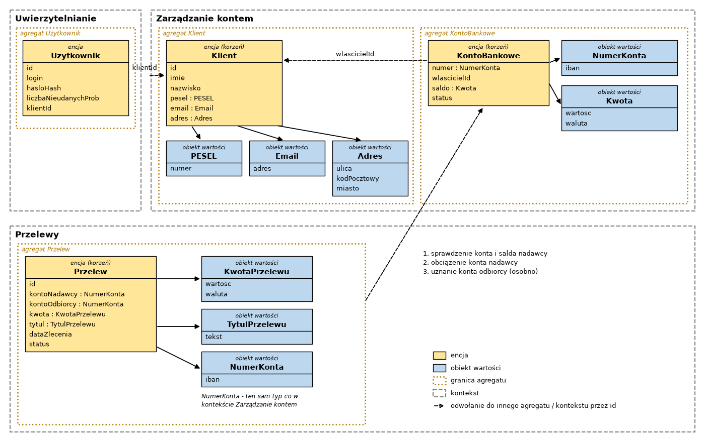

# Zadanie 1 - Domain Driven Design

## Opis

W zadaniu zamodelowałem fragment aplikacji bankowej z użyciem DDD. Wybrałem fragment dotyczący zlecania
przelewu z konta klienta. Podzieliłem go na trzy konteksty: Uwierzytelnianie, Zarządzanie kontem i Przelewy.
Dla każdego kontekstu wypisałem agregaty, encje i obiekty wartości oraz ograniczenia, jakie muszą spełniać ich dane.

## Model

## Konteksty

- **Uwierzytelnianie** - logowanie użytkownika do bankowości.
- **Zarządzanie kontem** - dane klienta i jego konta bankowe (saldo, status).
- **Przelewy** - tworzenie i realizacja przelewów między kontami.

Konteksty komunikują się tylko przez identyfikatory (`klientId`, numer konta), a nie przez całe obiekty.

## Agregaty

| Agregat | Korzeń | Co należy do agregatu |
|---|---|---|
| Uzytkownik | Uzytkownik | - |
| Klient | Klient | PESEL, Email, Adres |
| KontoBankowe | KontoBankowe | NumerKonta, Kwota (saldo) |
| Przelew | Przelew | KwotaPrzelewu, TytulPrzelewu, NumerKonta (nadawcy i odbiorcy) |

Zmiany wewnątrz agregatu są możliwe tylko przez jego korzeń. Agregaty odwołują się do siebie tylko przez id
(np. KontoBankowe ma `wlascicielId`, a nie cały obiekt Klient).

## Encje

| Encja | Kontekst | Atrybuty | Ograniczenia |
|---|---|---|---|
| Uzytkownik | Uwierzytelnianie | id, login, hasloHash, liczbaNieudanychProb, klientId | login 6-32 znaki (litery, cyfry, `.`, `_`), hasło przechowywane tylko jako hash, liczbaNieudanychProb to liczba całkowita 0-5, po 5 nieudanych próbach logowania konto jest blokowane |
| Klient | Zarządzanie kontem | id, imie, nazwisko, pesel, email, adres | imię i nazwisko po 2-50 znaków (tylko litery, `-`, spacja), PESEL nie może być zmieniony po utworzeniu klienta |
| KontoBankowe | Zarządzanie kontem | numer, wlascicielId, saldo, status | saldo nie może spaść poniżej 0, status: AKTYWNE / ZABLOKOWANE / ZAMKNIETE, operacje tylko na koncie o statusie AKTYWNE |
| Przelew | Przelewy | id, kontoNadawcy, kontoOdbiorcy, kwota, tytul, dataZlecenia, status | konto nadawcy musi należeć do zalogowanego klienta, konto nadawcy ≠ konto odbiorcy, po zleceniu nie można zmienić kwoty ani odbiorcy, dataZlecenia ustawiana automatycznie przez system przy utworzeniu przelewu, status: NOWY / ZATWIERDZONY / ZREALIZOWANY / ODRZUCONY |

Id wszystkich encji to UUID generowane przez system.

## Obiekty wartości

| Obiekt wartości | Atrybuty | Ograniczenia |
|---|---|---|
| PESEL | numer | dokładnie 11 cyfr, poprawna suma kontrolna |
| Email | adres | max 254 znaki, dokładnie jeden `@`, poprawny format domeny |
| Adres | ulica, kodPocztowy, miasto | ulica do 100 znaków, kod pocztowy w formacie `NN-NNN`, miasto 2-50 liter |
| NumerKonta | iban | `PL` + 26 cyfr, poprawna suma kontrolna IBAN; ten sam typ jest używany w kontekście Zarządzanie kontem i Przelewy |
| Kwota | wartosc, waluta | liczba z max 2 miejscami po przecinku, ≥ 0, waluta PLN |
| KwotaPrzelewu | wartosc, waluta | wartość od 0,01 do 100 000,00, max 2 miejsca po przecinku, waluta PLN |
| TytulPrzelewu | tekst | 1-140 znaków, tylko litery, cyfry, spacja i `. , - /` |

Obiekty wartości są niezmienne i sprawdzają poprawność danych przy tworzeniu, więc nie da się utworzyć np.
przelewu z ujemną kwotą albo z niepoprawnym numerem konta.

## Operacje między kontekstami

1. Po zalogowaniu Uwierzytelnianie przekazuje `klientId` zalogowanego klienta.
2. Przy zleceniu przelewu kontekst Przelewy prosi Zarządzanie kontem o sprawdzenie, czy konto nadawcy należy do klienta
   i czy ma wystarczające saldo.
3. Po zatwierdzeniu przelewu konto nadawcy jest obciążane. Uznanie konta odbiorcy to osobna operacja (osobna
   transakcja), bo jedna transakcja zmienia tylko jeden agregat, a konto odbiorcy może być też w innym banku.

Statusy przelewu: `NOWY` → `ZATWIERDZONY` → `ZREALIZOWANY`, albo `ODRZUCONY` (np. brak środków).

## Bezpieczeństwo

- Dane są walidowane przy tworzeniu obiektów wartości w backendzie, a nie tylko w formularzu.
- Biała lista znaków w tytule przelewu i w imieniu/nazwisku chroni przed wstrzyknięciem kodu (np. XSS).
- `klientId` jest brany z tokenu sesji, a nie z danych przesłanych przez użytkownika, więc nie da się zlecić
  przelewu z cudzego konta przez podmianę id w żądaniu.
- Blokada po 5 nieudanych próbach logowania utrudnia zgadywanie hasła.
